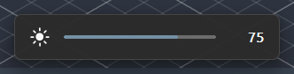
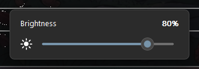
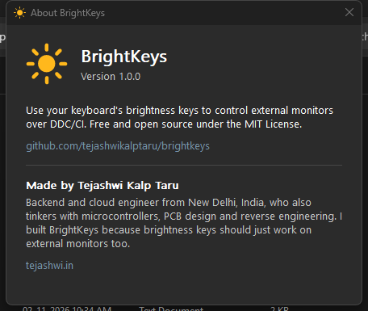

<p align="center">
  
</p>

<h1 align="center">BrightKeys</h1>

<p align="center">
  <b>Make your keyboard's brightness keys work on external monitors in Windows.</b><br>
  A tiny, free and open-source tray app that controls monitor brightness over DDC/CI with hotkeys.
</p>

<p align="center">
  <a href="https://github.com/tejashwikalptaru/brightkeys/releases/latest"></a>
  <a href="https://github.com/tejashwikalptaru/brightkeys/actions/workflows/release.yml"></a>
  <a href="https://github.com/tejashwikalptaru/brightkeys/releases"></a>
  <a href="LICENSE"></a>
  <a href="#verify-your-download"></a>
</p>

<p align="center">
  
</p>

---

## Why

On a desktop PC, or a laptop with an external display, the **brightness keys do nothing**. Windows only
dims built-in laptop panels, so changing an external monitor means fiddling with the buttons on its back.

Monitors can be controlled from the PC through **DDC/CI**, and apps like Monitorian and Twinkle Tray
give you a brightness slider. But binding the *keyboard* to it is either paid or needs a heavyweight app.
BrightKeys does just that one job:

- **Your keyboard's brightness keys just work**, including desktop keyboards that send HID brightness codes
- **Any key or combination can be bound.** Press it once in *learn* mode; Ctrl+Alt+PgUp / PgDn works out of the box
- **Tiny and native.** A ~200 KB C program using ~5 MB of RAM, with no .NET, Electron or runtime to install
- **Slider in the tray**, presets, adjustable step size, and a Windows 11-style on-screen indicator
- **All monitors at once.** Every DDC/CI display is set together
- **Stays in sync** if you change brightness with the monitor's own buttons
- **Starts with Windows** and follows light/dark mode and your accent color

## Download

Get the latest version from **[Releases](https://github.com/tejashwikalptaru/brightkeys/releases/latest)**:

| File | Description |
|---|---|
| `BrightKeys-x.y.z-setup-x64.exe` | Installer. No admin rights needed; adds a Start menu entry and an optional start-at-sign-in |
| `BrightKeys-x.y.z-portable-x64.zip` | Portable. Unzip anywhere and run `BrightKeys.exe` |

**Requirements:** Windows 10 or 11 and a monitor with **DDC/CI** support. Most monitors from the last
decade have it, but some ship with it switched off. Look for "DDC/CI" in the monitor's on-screen menu.

> **Windows SmartScreen** may warn about an unrecognized app, because the binaries aren't code-signed yet.
> Choose *More info → Run anyway*. See below for how each release is checked.

### Verify your download

Every release is built and checked entirely by GitHub Actions. Nothing is built or uploaded by hand.

| Check | What it means |
|---|---|
| **Built from source in CI** | Each release links to the exact commit and workflow run that produced it |
| **Microsoft Defender** | The files are scanned with up-to-date signatures before publishing; a detection blocks the release |
| **VirusTotal** | Each release's notes link to the VirusTotal reports (70+ antivirus engines) for its files |
| **Build provenance** | Files are signed with [Sigstore](https://www.sigstore.dev/) build attestations, checkable with the GitHub CLI |
| **Checksums** | `SHA256SUMS.txt` is attached to every release |

```sh
gh attestation verify BrightKeys-1.0.0-setup-x64.exe -R tejashwikalptaru/brightkeys
```

BrightKeys uses a low-level keyboard hook to detect its hotkeys. It only compares key presses against your
bindings, and it never logs, stores or sends anything. It makes no network connections at all. Because keyboard
hooks are also used by malware, an occasional heuristic false positive from a lesser-known engine is
possible; please [report it](https://github.com/tejashwikalptaru/brightkeys/issues) if you see one.

## Usage

| | |
|---|---|
| **Brightness up / down** | Your keyboard's brightness keys, or **Ctrl + Alt + PgUp / PgDn** |
| **Slider** | Left-click the tray icon (drag, mouse wheel, arrow keys, Home / End) |
| **Options** | Right-click the tray icon |
| **Use a different key** | Right-click → *Hotkeys* → *Add brightness up key…*, then press the key |

<p align="center"></p>

### My keyboard's brightness keys don't do anything

Try *Hotkeys → Add brightness up key…* and press the brightness key. If BrightKeys reports that nothing
was detected, your keyboard handles that key in its own firmware and never tells Windows about it (common
with Fn-layer keys on some keyboards). Bind another key or combination instead, e.g. `Ctrl + Alt + F11`.

### "No DDC/CI monitor found"

- Enable **DDC/CI** in the monitor's on-screen menu
- Some docks, KVM switches and USB/DisplayLink adapters don't pass DDC/CI through; try a direct cable
- With **HDR** on, some monitors ignore DDC/CI brightness

## Build from source

Requires Visual Studio 2019+ (or Build Tools) with the **Desktop development with C++** workload, which
includes MSVC, the Windows SDK, CMake and Ninja.

```bat
git clone https://github.com/tejashwikalptaru/brightkeys.git
cd brightkeys
build.bat                         :: -> build\BrightKeys.exe
powershell scripts\package.ps1 -Version 1.0.0 -SkipInstaller   :: optional: portable zip in dist\
```

The project also opens directly in Visual Studio, VS Code or CLion as a CMake project.

### Project layout

```
src/            the app, one module per concern (see src/brightkeys.h for an overview)
res/            icon, version resource, application manifest
installer/      Inno Setup script
scripts/        packaging, version computation, icon generator
.github/        CI for pull requests, automatic releases from main
```

### How it works

- **DDC/CI**: `SetVCPFeature` from `dxva2.dll`, VCP code `0x10` (luminance). Monitor I/O runs on a worker
  thread that merges rapid requests, so holding a key never lags.
- **Brightness keys**: Raw Input on the HID Consumer Control collection, decoded with `HidP_GetUsages`
  (usages `0x6F` / `0x70`). Windows ignores these keys when there's no built-in panel, but the HID reports still arrive.
- **Hotkeys**: a low-level keyboard hook. Matched keys are swallowed so the focused app doesn't also receive them.
- **UI**: plain Win32 + GDI, anti-aliased via supersampling, per-monitor DPI aware.

Settings live in `%APPDATA%\BrightKeys\settings.ini`.

## Releases and versioning

Every merge to `main` builds and publishes a release automatically. The version is derived from
[Conventional Commit](https://www.conventionalcommits.org/) messages since the last release:

| Commit message | Version bump |
|---|---|
| `fix: …`, `chore: …`, anything else | patch: 1.2.**3** → 1.2.**4** |
| `feat: …` | minor: 1.**2**.3 → 1.**3**.0 |
| `feat!: …` or a `BREAKING CHANGE:` footer | major: **1**.2.3 → **2**.0.0 |

Changes that only touch documentation or CI workflows don't create a release. To release them anyway,
run the *Release* workflow manually from the Actions tab.

## Code signing policy

Windows releases are intended to be signed through the SignPath Foundation's free program for open-source
projects. **Status:** application pending. Until it's approved, releases are unsigned (see
[Verify your download](#verify-your-download)).

Once approved: free code signing provided by [SignPath.io](https://about.signpath.io), certificate by
[SignPath Foundation](https://signpath.org).

- Only binaries built from this repository's source by the [release workflow](.github/workflows/release.yml) are signed.
- Every signing request is approved manually by an approver.

**Team roles**

| Role | Members |
|---|---|
| Committers and reviewers | [@tejashwikalptaru](https://github.com/tejashwikalptaru) |
| Approvers | [@tejashwikalptaru](https://github.com/tejashwikalptaru) |

**Privacy policy:** This program will not transfer any information to other networked systems unless
specifically requested by the user or the person installing or operating it. ("Check for updates" and the
links in the About window only open pages in your browser when you click them.)

## Contributing

Issues and pull requests are welcome. See [CONTRIBUTING.md](CONTRIBUTING.md).

## Author

Made by **Tejashwi Kalp Taru**, a backend and cloud engineer from New Delhi who also tinkers with
microcontrollers, PCB design and reverse engineering. [tejashwi.in](https://tejashwi.in)

<p align="center"></p>

## License

[MIT](LICENSE)
